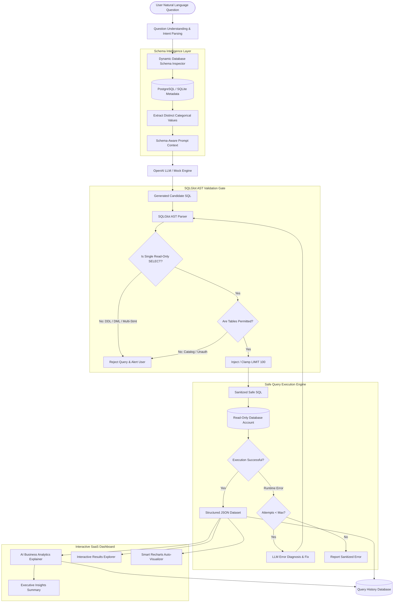
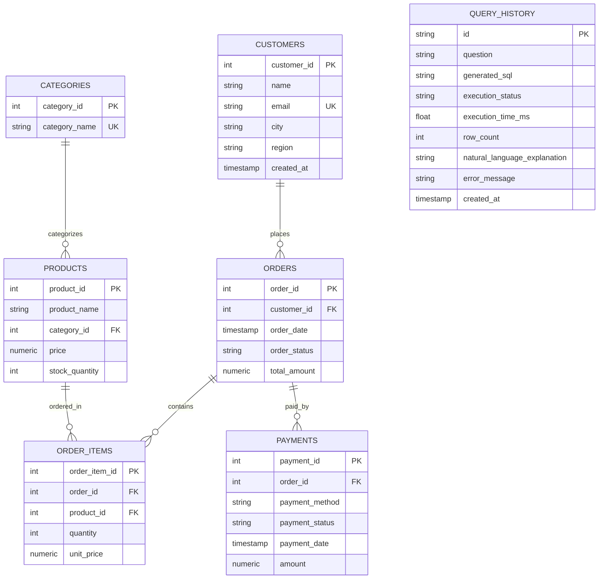

# DataPilot: Natural Language to SQL Analytics Agent


> **DataPilot** is an enterprise-grade Natural Language to SQL Analytics platform designed for a 2026 AI & Data Science Computer Science graduate. It allows business stakeholders and data analysts to converse directly with structured relational databases in plain English without writing manual SQL, backed by dynamic schema intelligence, SQLGlot Abstract Syntax Tree (AST) validation, bounded self-correcting query execution, and executive-ready natural language explanations.

---

## 1. Project Overview & Problem Statement

Modern enterprise data remains locked inside relational database management systems (RDBMS) like PostgreSQL. Non-technical decision makers, business executives, and product managers frequently face bottlenecks waiting on BI engineers to write custom SQL for routine exploratory queries.

However, naive "Text-to-SQL" wrappers that pass database credentials directly to Large Language Models (LLMs) present severe vulnerabilities:
1. **Security Vulnerabilities**: High risk of prompt injection, data tampering (`UPDATE`, `DELETE`, `DROP`), and unauthorized data exfiltration (`pg_catalog`, internal user tables).
2. **Schema Hallucinations**: LLMs frequently hallucinate non-existent table or column names without dynamic grounding.
3. **Execution Instability**: Generated queries often fail on aggregations, joins, or syntax errors with no automated recovery.
4. **Cognitive Overhead**: Raw tabular dumps overwhelm users who require executive insights rather than rows of raw numbers.

**DataPilot solves this problem end-to-end** through an isolated, multi-stage architecture combining dynamic schema inspection, AST-based security gates, bounded error correction loops, and dedicated read-only database connections.

---

## 2. Core Architecture & Workflow

### 2.1 Multi-Agent GenAI Execution Pipeline



---

## 3. Database Architecture & ER Diagram

DataPilot is pre-configured with a realistic e-commerce analytics schema containing 7 core tables, foreign key constraints, indexes, and seeded with 14 months of transactional data:



---

## 4. SQL Safety & Security Implementation

DataPilot treats SQL security as a core architectural constraint. It guarantees that **no LLM-generated code touches the database without passing through five independent security gates**:

| Layer | Security Control | Implementation Details |
| :--- | :--- | :--- |
| **Gate 1** | **SQLGlot AST Parsing** | Parses the raw query into an Abstract Syntax Tree. Blocks non-SELECT root AST nodes (`Insert`, `Update`, `Delete`, `Drop`, `AlterTable`, `TruncateTable`, `Create`, `Grant`, `Revoke`, `Command`). |
| **Gate 2** | **Multi-Statement Blocker** | Rejects stacked query attempts (e.g. `SELECT * FROM customers; DROP TABLE orders;`). Only exactly 1 expression is permitted. |
| **Gate 3** | **System Catalog & Function Shield** | Rejects references to `pg_catalog`, `information_schema`, `sqlite_master`, `pg_tables`, `current_user`, `session_user`, or sleep/delay functions. |
| **Gate 4** | **Authorized Table Whitelist** | Recursively traverses `exp.Table` nodes. Disallows any table outside `{categories, products, customers, orders, order_items, payments}` while properly resolving CTE aliases. |
| **Gate 5** | **Execution Clamps & Timeouts** | Injects or clamps `LIMIT 100` into the AST tree to prevent memory exhaustion. Applies `statement_timeout = 10000ms` at connection time. |
| **Gate 6** | **Read-Only Database Account** | In PostgreSQL, queries execute under a dedicated `datapilot_ro` role with strictly `GRANT SELECT` and explicit `REVOKE` on all write permissions. |

---

## 5. Technology Stack

- **Backend Framework**: Python 3.12+, FastAPI (Modular Routers, Dependency Injection, Lifespan Management)
- **Data Validation & Settings**: Pydantic v2 & Pydantic-Settings
- **ORM & Database Driver**: SQLAlchemy 2.0+, Psycopg2-binary, SQLite (dual-engine compatibility)
- **SQL Parser & Security Engine**: SQLGlot 30.x (AST traversal and dialect rewriting)
- **AI / LLM Integration**: OpenAI Python SDK (GPT-4o, GPT-4o-mini, with documented intelligent mock fallback)
- **Frontend Framework**: React 18, Vite 5, Tailwind CSS 3.4
- **Data Visualization**: Recharts (Dynamic Bar, Line, Area, and Pie charts)
- **Icons & UI System**: Lucide React
- **HTTP Client**: Axios
- **Testing & Quality Assurance**: Pytest 9.x, HTTPX, Pytest-Asyncio
- **Containerization**: Docker, Docker Compose, Nginx Alpine

---

## 6. Directory Structure

```text
datapilot/
│
├── backend/
│   ├── app/
│   │   ├── main.py                     # FastAPI application entrypoint & middleware
│   │   ├── core/
│   │   │   ├── config.py               # Pydantic BaseSettings & env configuration
│   │   │   └── logging.py              # Centralized structured logger
│   │   ├── api/
│   │   │   ├── health.py               # GET /api/health
│   │   │   ├── schema.py               # GET /api/schema, /tables, /tables/{name}
│   │   │   └── query.py                # POST /api/query, /validate, /history
│   │   ├── database/
│   │   │   └── connection.py           # Engine & SessionLocal (Primary & Read-Only)
│   │   ├── models/
│   │   │   ├── ecommerce.py            # SQLAlchemy models for 6 business tables
│   │   │   └── history.py              # QueryHistory persistence model
│   │   ├── schemas/
│   │   │   ├── schema.py               # Pydantic schemas for database inspection
│   │   │   └── query.py                # Request/response models for query pipeline
│   │   ├── services/
│   │   │   ├── schema_service.py       # Dynamic SQLAlchemy Inspector & context builder
│   │   │   ├── sql_validator.py        # SQLGlot AST security validation gate
│   │   │   ├── query_executor.py       # Safe read-only execution with timeouts & limits
│   │   │   ├── llm_service.py          # OpenAI client & intelligent mock generator
│   │   │   ├── sql_generator.py        # Pipeline orchestrator with error correction
│   │   │   └── result_explainer.py     # AI business insight explainer
│   │   ├── prompts/
│   │   │   ├── sql_generation.py       # Zero-shot schema-grounded SQL generation
│   │   │   ├── sql_correction.py       # Error-aware self-healing SQL prompt
│   │   │   └── result_explanation.py   # Business insight synthesis prompt
│   │   └── utils/
│   ├── tests/
│   │   ├── conftest.py                 # Pytest fixtures and test database setup
│   │   ├── test_sql_validator.py       # 12 Security AST tests (DML, DDL, injections)
│   │   ├── test_schema_service.py      # Schema discovery & context tests
│   │   ├── test_query_executor.py      # Safe execution & timeout tests
│   │   ├── test_llm_pipeline.py        # Pipeline orchestration & correction limit tests
│   │   └── test_api_endpoints.py       # FastAPI endpoint & history lifecycle tests
│   ├── Dockerfile                      # Production Python 3.12 container
│   ├── requirements.txt                # Pinned production dependencies
│   └── venv/                           # Dedicated virtual environment
│
├── frontend/
│   ├── src/
│   │   ├── components/
│   │   │   ├── Navbar.jsx              # System status, health badges & actions
│   │   │   ├── Sidebar.jsx             # Navigation tabs & security status
│   │   │   ├── QueryAssistant.jsx      # Natural language chat, pipeline visualizer & SQL display
│   │   │   ├── ResultsExplorer.jsx     # Interactive data table, sorting & CSV export
│   │   │   ├── VisualAnalytics.jsx     # Recharts engine (Bar, Line, Area, Pie)
│   │   │   ├── SchemaExplorer.jsx      # Dynamic ER metadata & sample values viewer
│   │   │   └── QueryHistoryView.jsx    # Execution audit log & re-run controls
│   │   ├── pages/
│   │   │   └── DashboardOverview.jsx   # Executive overview, KPI cards & featured inquiries
│   │   ├── services/
│   │   │   └── api.js                  # Axios client for backend endpoints
│   │   ├── App.jsx                     # Root application container & state manager
│   │   ├── main.jsx                    # React 18 DOM mount point
│   │   └── index.css                   # Tailwind directives & typography
│   ├── Dockerfile                      # Multi-stage Node + Nginx container
│   ├── nginx.conf                      # Nginx reverse proxy configuration
│   ├── package.json                    # Dependencies & scripts
│   ├── tailwind.config.js              # Theme customization
│   └── vite.config.js                  # Vite server & API proxy config
│
├── database/
│   ├── schema.sql                      # PostgreSQL DDL with indexes
│   ├── init_ro_user.sql                # PostgreSQL read-only user setup script
│   └── seed.py                         # Realistic e-commerce seeder (Postgres + SQLite)
│
├── docker-compose.yml                  # 3-tier container setup (DB, Backend, Frontend)
├── .env.example                        # Template environment variables
├── .env                                # Local environment configuration
├── pytest.ini                          # Pytest configuration
├── start_backend.bat                   # 1-click backend launcher
├── start_frontend.bat                  # 1-click frontend launcher
├── run_all.bat                         # 1-click end-to-end launcher
└── README.md                           # Comprehensive documentation & interview notes
```

---

## 7. Installation & Quick Start

### 7.1 Prerequisites
- Python 3.11+
- Node.js 18+ & npm
- Git (optional)
- Docker & Docker Compose (optional, for full containerized stack)

---

### 7.2 Method A: Local Fast Start (Zero-Dependency SQLite Mode)

DataPilot includes an automatic zero-configuration SQLite runtime that requires no external database setup.

#### Step 1: Clone and Enter Directory
```powershell
cd "c:\Users\saras\Desktop\data pilot"
```

#### Step 2: Set Environment Variables
Copy `.env.example` to `.env`:
```powershell
cp .env.example .env
```
*(Leave `OPENAI_API_KEY=` blank to use the built-in Mock LLM Engine, or add your OpenAI API key).*

#### Step 3: Seed the Database
Run the deterministic seeder using the pre-configured virtual environment:
```powershell
backend\venv\Scripts\python.exe database\seed.py
```
*Output: Seeds categories, 27 products, 30 customers, 120 orders, 226 order items, and 120 payments.*

#### Step 4: Launch Backend
```powershell
backend\venv\Scripts\python.exe -m uvicorn backend.app.main:app --host 0.0.0.0 --port 8000 --reload
```
*The API is now live at `http://localhost:8000` with Swagger docs at `http://localhost:8000/docs`.*

#### Step 5: Launch Frontend
Open a new terminal and run:
```powershell
cd frontend
npm run dev
```
*The interactive dashboard will open at `http://localhost:5173`.*

---

### 7.3 Method B: Full Docker Compose Stack (PostgreSQL + Read-Only Account)

To run the complete production PostgreSQL architecture:
```powershell
docker-compose up --build
```
This automatically boots:
- **PostgreSQL 16** with tables, indexes, and the `datapilot_ro` read-only role (`port 5432`).
- **FastAPI Backend** connected to PostgreSQL (`port 8000`).
- **React Frontend** hosted on Nginx (`port 3000`).

---

## 8. Automated Testing & Verification

DataPilot contains a test suite of **25 unit and integration tests** verifying all security layers, schema inspection, query execution, error correction, and API endpoints.

To run tests:
```powershell
backend\venv\Scripts\pytest.exe -v backend/tests
```

### Test Suite Summary:
```text
backend/tests/test_api_endpoints.py::test_health_endpoint PASSED         [  4%]
backend/tests/test_api_endpoints.py::test_schema_endpoints PASSED        [  8%]
backend/tests/test_api_endpoints.py::test_query_validation_endpoint PASSED [ 12%]
backend/tests/test_api_endpoints.py::test_query_execution_and_history_lifecycle PASSED [ 16%]
backend/tests/test_llm_pipeline.py::test_pipeline_top_products_question PASSED [ 20%]
backend/tests/test_llm_pipeline.py::test_pipeline_region_sales_question PASSED [ 24%]
backend/tests/test_llm_pipeline.py::test_pipeline_out_of_domain_clarification PASSED [ 28%]
backend/tests/test_llm_pipeline.py::test_pipeline_correction_limit_bound PASSED [ 32%]
backend/tests/test_query_executor.py::test_query_executor_success PASSED [ 36%]
backend/tests/test_query_executor.py::test_query_executor_empty_results PASSED [ 40%]
backend/tests/test_query_executor.py::test_query_executor_error_handling PASSED [ 44%]
backend/tests/test_schema_service.py::test_schema_inspection PASSED      [ 48%]
backend/tests/test_schema_service.py::test_prompt_schema_context_generation PASSED [ 52%]
backend/tests/test_sql_validator.py::test_valid_select_queries PASSED    [ 56%]
backend/tests/test_sql_validator.py::test_multiple_statements_rejection PASSED [ 60%]
backend/tests/test_sql_validator.py::test_insert_rejection PASSED        [ 64%]
backend/tests/test_sql_validator.py::test_update_rejection PASSED        [ 68%]
backend/tests/test_sql_validator.py::test_delete_rejection PASSED        [ 72%]
backend/tests/test_sql_validator.py::test_drop_rejection PASSED          [ 76%]
backend/tests/test_sql_validator.py::test_alter_rejection PASSED         [ 80%]
backend/tests/test_sql_validator.py::test_truncate_rejection PASSED      [ 84%]
backend/tests/test_sql_validator.py::test_system_catalog_rejection PASSED [ 88%]
backend/tests/test_sql_validator.py::test_unauthorized_table_rejection PASSED [ 92%]
backend/tests/test_sql_validator.py::test_limit_enforcement PASSED       [ 96%]
backend/tests/test_sql_validator.py::test_malformed_sql_handling PASSED  [100%]

======================= 25 passed in 0.36s =======================
```

---

## 9. API Reference

### Health
`GET /api/health`
- **Response**:
  ```json
  {
    "status": "healthy",
    "database": "connected",
    "database_type": "SQLite",
    "openai_configured": false,
    "llm_mode": "Mock Engine",
    "version": "1.0.0",
    "environment": "development"
  }
  ```

### Schema Intelligence
`GET /api/schema`
- **Response**: Discovered tables, columns, primary keys, foreign key joins, sample values, and row counts.

`GET /api/schema/tables`
- **Response**: `["categories", "products", "customers", "orders", "order_items", "payments"]`

`GET /api/schema/tables/{table_name}`
- **Response**: Detailed schema of single table.

`POST /api/schema/refresh`
- **Response**: Invalidation confirmation and re-scanned table count.

### Query Engine
`POST /api/query`
- **Request Body**:
  ```json
  { "question": "What are the top 5 products by revenue?" }
  ```
- **Response**:
  ```json
  {
    "query_id": "3b8a1c90-...",
    "question": "What are the top 5 products by revenue?",
    "generated_sql": "SELECT p.product_name, ROUND(SUM(oi.quantity * oi.unit_price), 2) AS total_revenue, SUM(oi.quantity) AS total_units_sold FROM products p JOIN order_items oi ON p.product_id = oi.product_id JOIN orders o ON oi.order_id = o.order_id WHERE o.order_status = 'completed' GROUP BY p.product_id, p.product_name ORDER BY total_revenue DESC LIMIT 5",
    "execution_status": "success",
    "execution_time_ms": 2.5,
    "columns": ["product_name", "total_revenue", "total_units_sold"],
    "rows": [
      { "product_name": "Ultra-Slim 14-inch Laptop", "total_revenue": 7699.93, "total_units_sold": 7 },
      { "product_name": "Smart 4K Ultra HD TV 55-inch", "total_revenue": 6990.0, "total_units_sold": 10 }
    ],
    "row_count": 5,
    "explanation": "Top Performer: Ultra-Slim 14-inch Laptop leads with $7,699.93 in total revenue across completed orders.",
    "is_mock": true
  }
  ```

`POST /api/query/validate`
- **Request Body**: `{ "sql": "DROP TABLE customers" }`
- **Response**:
  ```json
  {
    "is_valid": false,
    "error": "Security rejection: Only read-only SELECT queries are permitted (received Drop).",
    "sanitized_sql": null,
    "tables_accessed": []
  }
  ```

`GET /api/query/history`
- Returns paginated query audit logs.

`DELETE /api/query/history/{query_id}`
- Removes an individual history entry.

---

## 10. Sample Canonical Analytics Questions & Generated SQL

### 1. Top 5 Products by Revenue
- **Question**: *"What are the top 5 products by revenue?"*
- **Generated SQL**:
  ```sql
  SELECT p.product_name,
         ROUND(SUM(oi.quantity * oi.unit_price), 2) AS total_revenue,
         SUM(oi.quantity) AS total_units_sold
  FROM products p
  JOIN order_items oi ON p.product_id = oi.product_id
  JOIN orders o ON oi.order_id = o.order_id
  WHERE o.order_status = 'completed'
  GROUP BY p.product_id, p.product_name
  ORDER BY total_revenue DESC
  LIMIT 5;
  ```

### 2. Highest Regional Sales
- **Question**: *"Which region generated the highest sales?"*
- **Generated SQL**:
  ```sql
  SELECT c.region,
         ROUND(SUM(o.total_amount), 2) AS total_sales,
         COUNT(o.order_id) AS total_orders
  FROM customers c
  JOIN orders o ON c.customer_id = o.customer_id
  WHERE o.order_status = 'completed'
  GROUP BY c.region
  ORDER BY total_sales DESC;
  ```

### 3. Monthly Revenue Trajectory
- **Question**: *"Show monthly revenue for the last 12 months."*
- **Generated SQL**:
  ```sql
  SELECT SUBSTRING(o.order_date, 1, 7) AS month,
         ROUND(SUM(o.total_amount), 2) AS monthly_revenue,
         COUNT(o.order_id) AS orders_count
  FROM orders o
  WHERE o.order_status = 'completed'
  GROUP BY SUBSTRING(o.order_date, 1, 7)
  ORDER BY month ASC
  LIMIT 100;
  ```

### 4. Customer Order Frequency
- **Question**: *"Which customers have placed the most orders?"*
- **Generated SQL**:
  ```sql
  SELECT c.name, c.email, c.city, c.region,
         COUNT(o.order_id) AS total_orders,
         ROUND(SUM(o.total_amount), 2) AS lifetime_value
  FROM customers c
  JOIN orders o ON c.customer_id = o.customer_id
  GROUP BY c.customer_id, c.name, c.email, c.city, c.region
  ORDER BY total_orders DESC
  LIMIT 10;
  ```

### 5. Sales Comparison Across Categories
- **Question**: *"Compare sales across different product categories."*
- **Generated SQL**:
  ```sql
  SELECT cat.category_name,
         ROUND(SUM(oi.quantity * oi.unit_price), 2) AS category_revenue,
         SUM(oi.quantity) AS total_quantity_sold
  FROM categories cat
  JOIN products p ON cat.category_id = p.category_id
  JOIN order_items oi ON p.product_id = oi.product_id
  JOIN orders o ON oi.order_id = o.order_id
  WHERE o.order_status = 'completed'
  GROUP BY cat.category_id, cat.category_name
  ORDER BY category_revenue DESC;
  ```

### 6. Average Order Value (AOV)
- **Question**: *"What is the average order value?"*
- **Generated SQL**:
  ```sql
  SELECT ROUND(AVG(total_amount), 2) AS average_order_value,
         ROUND(MIN(total_amount), 2) AS min_order_value,
         ROUND(MAX(total_amount), 2) AS max_order_value,
         COUNT(order_id) AS completed_orders
  FROM orders
  WHERE order_status = 'completed';
  ```

---

## 11. Technical Interview Preparation Notes

*Key talking points for software engineering & GenAI roles:*

1. **Why SQLGlot AST parsing instead of Regex for SQL validation?**
   - Regular expressions fail easily against SQL obfuscation (e.g. comments like `/* ... */`, line breaks, casing tricks, or subqueries). An AST parser parses SQL into a syntax tree, allowing explicit inspection of expression classes (`exp.Select`, `exp.Drop`). If a query contains a stacked statement or nested modification, the AST structure immediately catches it regardless of formatting.

2. **How does dynamic schema inspection improve LLM accuracy?**
   - Naive text-to-SQL prompts often assume generic schemas or hallucinate column names. DataPilot extracts real table definitions, column types, foreign keys, and low-cardinality categorical values (e.g. `region: ["North", "South", "East", "West"]`). Feeding distinct values in the prompt prevents the LLM from inventing filter strings like `WHERE region = 'Southern'`, ensuring exact WHERE-clause string matches.

3. **How does bounded self-correcting error handling work?**
   - When a generated SQL fails (either syntax error, column mismatch, or database runtime error), the pipeline intercepts the error, extracts the sanitized error message, and invokes the LLM with a targeted debugging prompt containing the failed SQL and the error context. Crucially, the corrected SQL must pass through the exact same SQLGlot AST validation gate before re-execution, preventing prompt injection bypasses. Correction attempts are bounded by `MAX_SQL_CORRECTION_ATTEMPTS=3`.

4. **Defense-in-Depth Principle**:
   - Security cannot rely on system prompts alone ("System: Please only write SELECT"). DataPilot implements defense-in-depth:
     1. Prompt constraints (GenAI layer)
     2. AST tree verification (Python application layer)
     3. Table and schema whitelist (Application security layer)
     4. Statement timeouts & LIMIT clamps (Resource layer)
     5. PostgreSQL read-only user privileges (Database kernel layer)

---

## 12. Limitations & Future Roadmap

- **Multi-Turn Conversational Memory**: Currently, each query is treated as an independent analytical task. Future releases will maintain conversation session context (e.g. *"Now filter that to only South region"*).
- **Vector Semantic Search on Schema**: For enterprise warehouses with thousands of tables, integrate ChromaDB/FAISS to retrieve only the top-k most relevant table schemas rather than full schema injection.
- **Export Formats**: Add native Excel (`.xlsx`) and PDF executive reporting exports.

---

## 13. License
MIT License. Built for the 2026 AI & Data Science Graduate Showcase.
